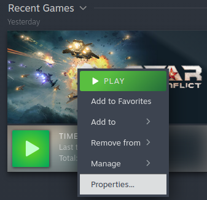
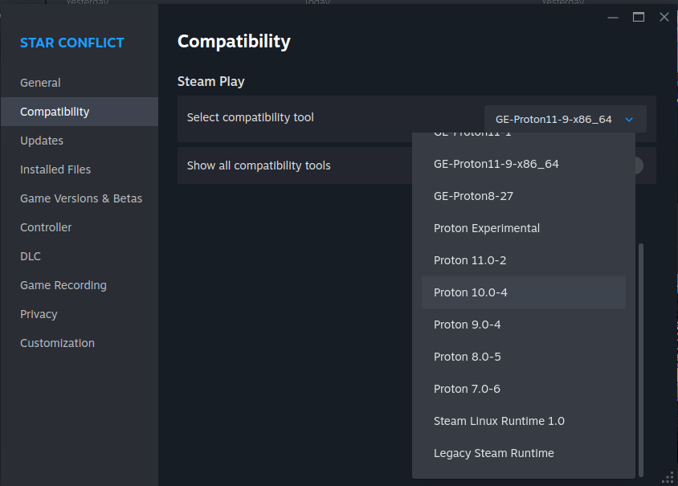

# Activate Proton on Steam

1. Right click the game.
2. Click on `Properties`.

3. Click on `Compatibility` on the left.
4. Select the compatibility tool to a Proton version.

5. Steam should now download the Windows version.