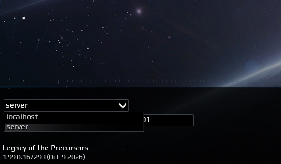
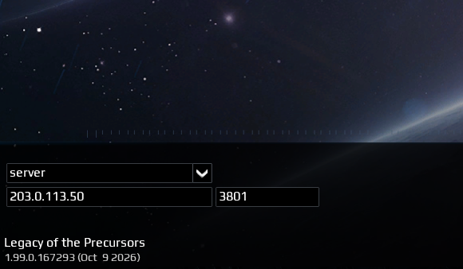

# Connect to a server

1. Launch the game.
2. On the bottom left, set the `localhost` to `server`

3. Enter the IP of the Server.
4. Keep the port on the default (`3801`).

5. Enter an username (**NOT EMAIL**).
6. Enter a password (**CREATE ONE SPECIALLY FOR THE SERVER YOUR CONNECTING TO**).

:::warning
The `username` entered will be viewed by the server owner.  
:::

:::danger
The `password` is not stored securely.  
And is reversable from the database.
:::