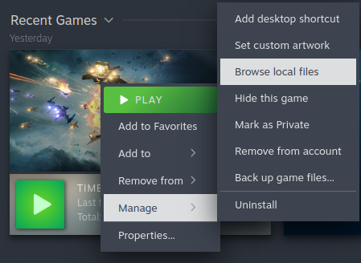
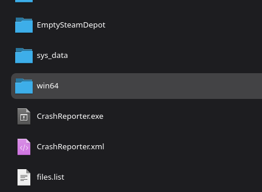
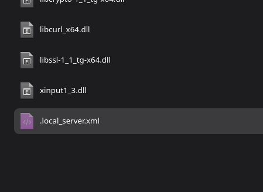

# Disable Startup of the Local Server

1. Right click the game.
2. Click on `Manage`.
3. Click on `Browse local files`.

4. Open the `win64` folder.

5. Rename the `local_server.xml` to `.local_server.xml`
   (add a `.` before the name).

6. The local server is now deactivated.  
   To reactivate it, remove the `.` from the name again.
