# Port Forwarding

The big question, how to port forward Star Conflict.  
In order for the Hub to start, in the `cloud.xml` file,
an IP address of the machine where the Hub is hosted should be entered,
however this IP is also sent to the client who will
connect to it.

## The Ports used

In order to access Star Conflict,
the following ports are used:

- `3801/tcp`: The Load balancer 
  (the client will first connect to this).
- `3802/tcp`: The Shard
  (the load balancer will redirect the client to this).
- `3815/tcp`: The Chat Server.
- `35000+/udp`: The Dedicated Server
  (one is started for each battle/openspace instance
  and uses the lowest port available)

## The (official) way to host

By using a server in the cloud (by using a VPS for exemple)
the server has it's public IP address on it's network interface
and all problems are "solved" as there is no need for port
forwarding...

## A hacky work-around

We can also try to add a virtual network interface
to the machine and set it to a static IP address
(the same as our public IP address).  
After that port forwarding should work like any other
game server.

:::warning
You will lose the ability to route from the server to
your public IP address (as this will be mapped to it's self).
:::

### Example Using Windows Server 2025

1. Open `Device manager`.

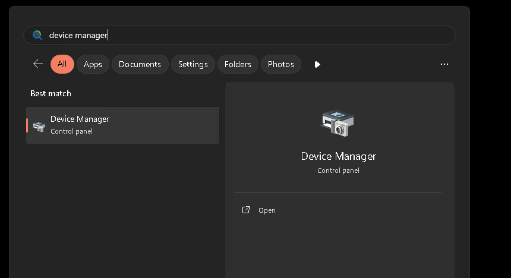

2. Click on `Network adapters`.
3. Click on `Action`.
4. Click on `Add legacy hardware`.

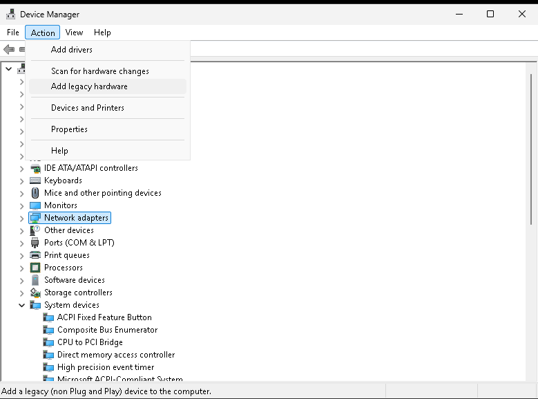

5. Click on `Next`.

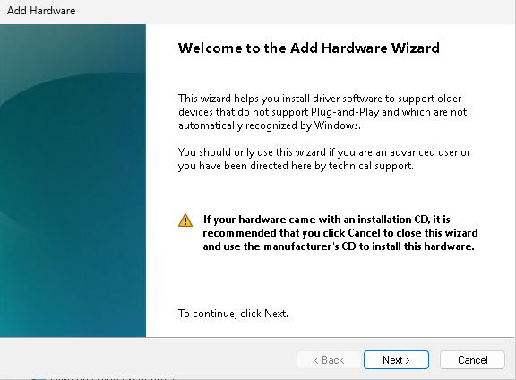

6. Select the `install the hardware that I manually select from a list (Advanced)`.
7. Click on `Next`.

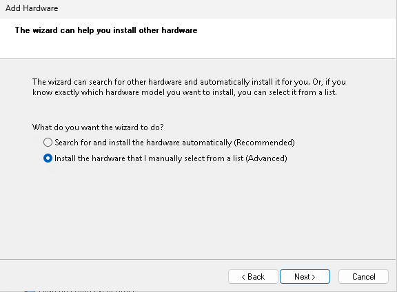

8. Select the `Network adapters`
9. Click on `Next`.

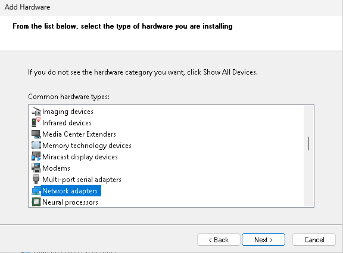

10. Select on the left plane `Microsoft`.
11. Select on the right plane `Microsoft KM-TEST Loopback Adapter`.
12. Click on `Next`.

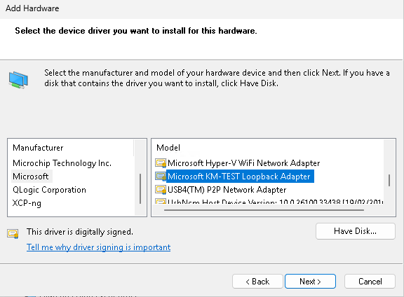

13. Click on `Next`.

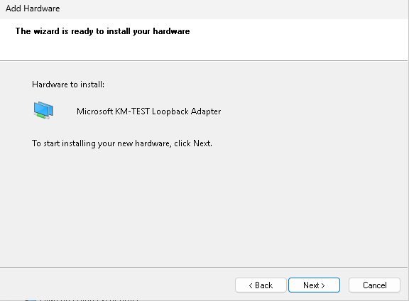

14. Click on `Finish`.

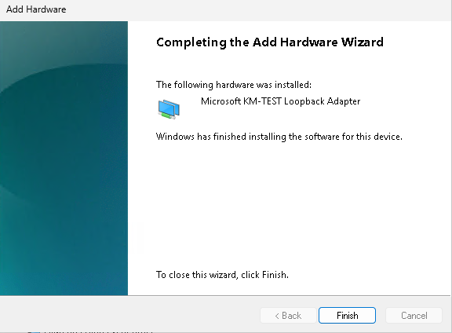

15. Open `Manage Network Adapter settings`

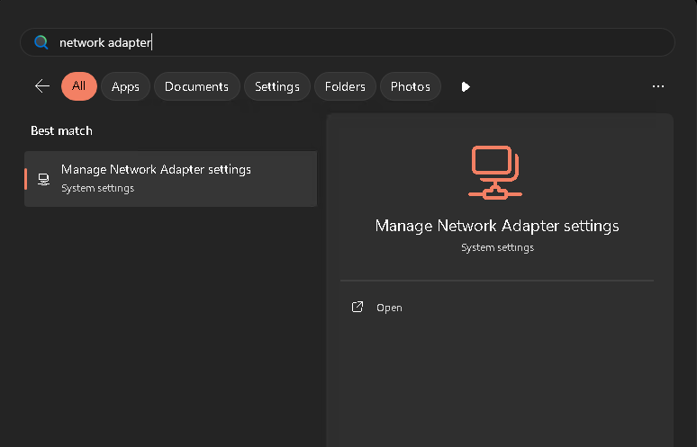

16. Click on the created network adapter
    (`Unidentified network | Microsoft KM-TEST Loopback Adapter`).

17. Click on `View additional properties`.

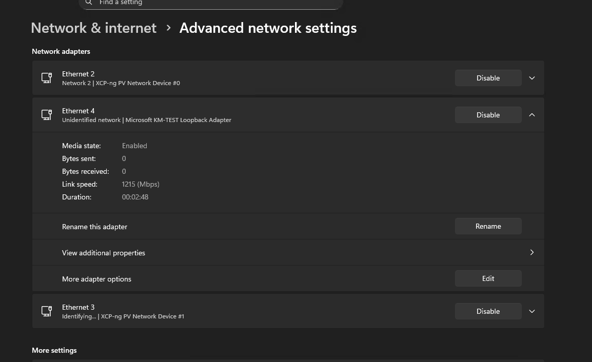

18. On the line `IP assignment` click on `Edit`.

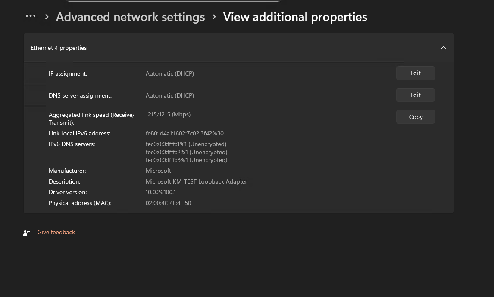

19. Set the `Automatic (DHCP)` to `Manual`.
20. Turn the `IPv4` on.
21. Enter in `IP address` your public IP Address.
22. Enter in `Subnet mask` `255.255.255.255` 
    (so it isn't used for routing outside the loopback).
23. Click on `Save`.

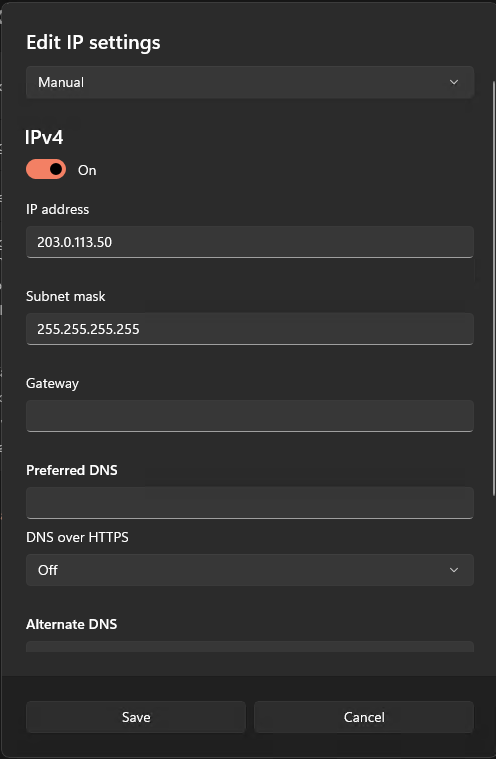

24. You can set in the `cloud.xml` your public IP address.  
    The Hub and its services will now communicate with each
    other over the loopback interface.  
    And when connected with a Client, you will receive the
    public IP address, and go through the router via the
    port forwarding.

```xml
<?xml version="1.0"?>
<Cloud debug="0" >
	<CommonCVars>
		<CVar name="dbg_disableLuaDataFormatChecking" value="1" />
	</CommonCVars>
	
	<Node address="203.0.113.50:3850" dediServerHost="1" id="1" region="1">
		<Service type="1" />
		<Service type="2" />
		<Service type="3" />
		<Service type="7" />
		<Service type="8" />
		<Service type="9" />
		<Service type="11" />
		<Service type="12" />
		<Service type="13" />
		<Service type="14" />
		<Service type="16" />
		<Service type="17" />
		<Service type="18" />
		<Service type="19" />
		<Service type="20" />
		<Service type="22" priority="0" />
		<Service type="23" />
	</Node>
</Cloud>
```